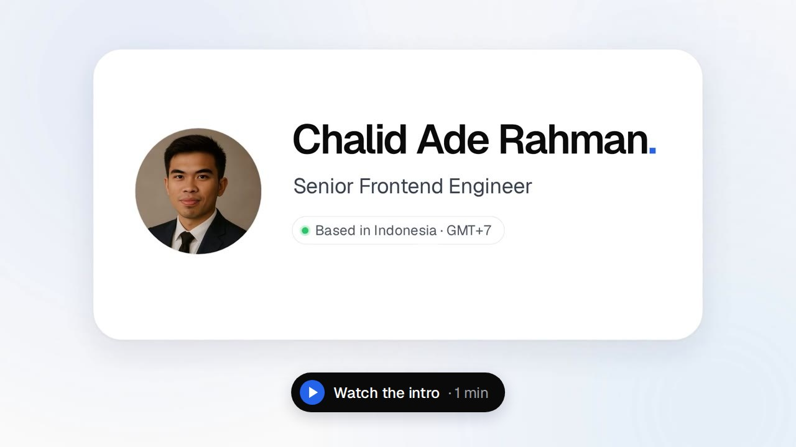

# Chalid Ade Rahman

**Senior Frontend Engineer** — React · Next.js · TypeScript · 8+ years

I build production web apps for global teams across EdTech, logistics and fintech. My day job is
**Lerero v2**, a white-label LMS and Stripe course marketplace (Next.js, React 19, TypeScript). I'm
its sole frontend engineer, with 490+ merged PRs. That code lives in private repos under a
separate work account ([@chalidade-kpi](https://github.com/chalidade-kpi)), so this account is
where I build in public.

## Six years on the work account

| Year | Contributions | What I was working on |
| --- | ---: | --- |
| 2021 | 941 | Lerero frontend and the Learning Reinforcement app |
| 2022 | 667 | Lerero LMS frontend |
| 2023 | 1,383 | LMS and the course marketplace |
| 2024 | 938 | LMS and marketplace |
| 2025 | 1,207 | Code review grew to 36% of my activity; promoted to technical lead in November |
| **Past 12 months** | **2,675** | Sole frontend engineer on Lerero v2, 490+ merged PRs |

5,100+ contributions from 2021 to 2025 (commits, pull requests and code reviews in private
repositories), from GitHub's contribution graph on [@chalidade-kpi](https://github.com/chalidade-kpi).

## What I'm building

| Project | What it is | Links |
| --- | --- | --- |
| **jobfair.co.id** | A virtual job fair you walk through as a character, live since a hybrid job fair opened on 30 October 2026: company stands, recruiter chats, career seminars and online applications. Coin payments on an append-only ledger with idempotency keys, and realtime movement sent as intent so a crowd fits a free tier. Next.js 15, Postgres + Drizzle, Supabase Realtime, Xendit. | [Live](https://jobfair.co.id) · private source |
| **Kuliah Indo** | A learning platform for Indonesian university students, live for two years: paid seminars and trainings taught by industry mentors, with free modules and certificates. 600+ registered students. Laravel, PHP, MySQL. | [Live](https://kuliahindo.com) · private source |
| **Kita Berkembang** | A store builder for Indonesian small businesses on WordPress Multisite: a store per subdomain, WhatsApp orders priced on the server, a map of open stores. 104 PHPUnit + 32 Playwright tests in CI. | [Live](https://kitaberkembang.com) · private source |
| **Saling Jaga** | Calls, walkie-talkie, chat and SOS between Android phones with no internet or signal, over Wi-Fi Direct, plus a LoRa gateway for longer range. Every link is encrypted (ECDH P-256, AES-256-GCM). Field-tested, ~350 KB APK, no third-party libraries. | [Live](https://saling-jaga.my.id) · private source |
| **[toowl](https://github.com/chalidade/tools)** | My everyday toolbox, free for everyone: 70+ tools for PDF, Office, image, video, audio, QR and everyday sums that run entirely in the browser. Each tool also ships as an npm package (a web component plus a headless API). | [Live](https://chalidade.github.io/tools/) · [Source](https://github.com/chalidade/tools) |
| **[weeknoo](https://github.com/chalidade/weeknoo)** | A website workspace: a prompt becomes a GitHub issue, Claude Code builds the site, and CI ships it to GitHub Pages plus an Android APK, or exports it as a WordPress block theme. | [Live](https://chalidade.github.io/weeknoo/) · [Source](https://github.com/chalidade/weeknoo) |

I build with Claude Code as a daily pair. I own the architecture, the constraints and the review,
and I write up what I learn in my **[devlog](https://github.com/chalidade/devlog)**. A few deeper notes:

- [Time-stretching audio in the browser](https://github.com/chalidade/devlog/blob/main/notes/time-stretching-audio-in-the-browser.md) (WSOLA, streamed)
- [Rebuilding tables from PDF text](https://github.com/chalidade/devlog/blob/main/notes/rebuilding-tables-from-pdf-text.md)
- [Paginating .docx in the browser](https://github.com/chalidade/devlog/blob/main/notes/paginating-docx-in-the-browser.md)

## Stack

- **Frontend:** React, Next.js (App Router), TypeScript, Tailwind CSS, Zustand, Redux Toolkit
- **Backend & data:** Node.js, PostgreSQL + Drizzle, Supabase Realtime, PHP, Laravel / Lumen, WordPress Multisite
- **Testing & CI:** Playwright, Vitest, Jest, PHPUnit, GitHub Actions
- **AI-assisted development:** Claude Code (CLAUDE.md contracts, scheduled routines), local LLMs via Ollama

## Find me

Indonesia (GMT+7) · [Portfolio](https://chalidade.github.io) · [LinkedIn](https://www.linkedin.com/in/chalidaderahman/) · [Medium](https://chalidade.medium.com/) · chalidade@gmail.com
